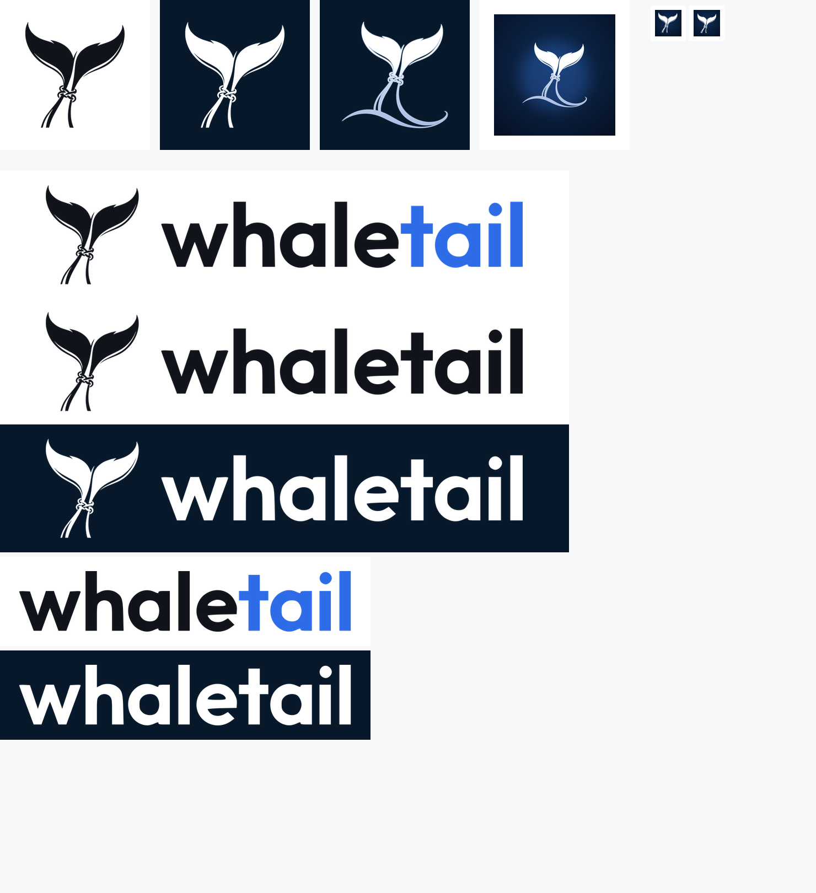

# whaletail 品牌资产（logo kit）

给后台、网页、文档、邮件签名、应用头像等场景用的独立品牌资产。**不属于小程序包**
（`miniprogram/` 之外），不影响 200 K 图片资源限制。

## 文件

### 矢量（SVG，推荐优先使用）

| 文件 | 用途 |
| --- | --- |
| `svg/mark-ink.svg` | 鲸尾标记，深色版（浅色背景） |
| `svg/mark-white.svg` | 鲸尾标记，白色版（深色背景/图片上） |
| `svg/mark-currentColor.svg` | 鲸尾标记，`fill="currentColor"`，由 CSS 决定颜色 |
| `svg/wordmark-ink.svg` | 纯色词标 `whaletail`（深色） |
| `svg/wordmark-white.svg` | 纯色词标（白色） |
| `svg/wordmark-color.svg` | 双色词标：`whale` 深色 + `tail` 品牌蓝 |
| `svg/wordmark-color-white.svg` | 双色词标，深色背景版（白 + 雾蓝） |
| `svg/lockup-ink.svg` | 横版组合：标记 + 深色词标（浅色背景） |
| `svg/lockup-white.svg` | 横版组合，纯白版（深色背景） |
| `svg/lockup-color.svg` | 横版组合，双色词标（品牌标准组合） |
| `svg/lockup-color-white.svg` | 横版组合，深色背景双色版 |

SVG 已含 `role="img"` 和 `aria-label`，可直接 `` 或内联使用；单色文件没有写死
尺寸属性，用 CSS 的 `width/height` 控制即可，等比缩放不会模糊。

### 位图（PNG，透明背景）

| 文件 | 用途 |
| --- | --- |
| `png/mark-ink-1024.png` / `-512` / `-256` | 标记，深色，透明底 |
| `png/mark-white-1024.png` / `-512` / `-256` | 标记，白色，透明底 |
| `png/mark-3d-1024.png` / `-512` / `-256` | 标记，3D 高光版（蓝边+渐变），透明底 |
| `png/wordmark-color-1404.png` / `-702` | 双色词标 |
| `png/wordmark-ink-1404.png` / `-702` | 纯深色词标 |
| `png/wordmark-white-1404.png` / `-702` | 纯白词标 |
| `png/lockup-color-2048.png` / `-1024` | 横版组合，双色（推荐） |
| `png/lockup-ink-2048.png` / `-1024` | 横版组合，深色 |
| `png/lockup-white-2048.png` / `-1024` | 横版组合，白色 |
| `png/app-icon-1024.png` | 方形应用图标（深海军蓝底 + 3D 鲸尾） |
| `png/app-icon-rounded-1024.png` | 同上，22.5% 圆角（头像/桌面图标） |
| `png/app-icon-512.png` / `-192` / `-180` | 应用图标常用尺寸（PWA / apple-touch-icon） |
| `png/favicon-32.png` / `-48` | 站点 favicon（深底白标，小尺寸更清晰） |

## 颜色

| 用途 | 色值 |
| --- | --- |
| 品牌墨色（`whale` 词标、浅色底标记） | `#10131A` |
| 品牌蓝（`tail` 词标、强调色） | `#2E6BE6` |
| 深海海军蓝（深色底、图标底） | `#07182B` |
| 雾蓝（深色底高光/副信息） | `#BFD4FF` |

## 使用建议

- **后台/网页顶栏**：主导航用 `lockup-color.svg`（浅色主题）或
  `lockup-color-white.svg`（深色主题）；空间不足时只用 `mark-*.svg`。
- **favicon**：`png/favicon-32.png`，或直接把 `favicon-32.png` 放进站点根目录。
- **应用图标/头像**：`app-icon-rounded-1024.png`；需要方形就用 `app-icon-1024.png`。
- **单色印刷/水印/遮罩**：`mark-ink.svg` 或 `mark-white.svg`，颜色可通过 CSS
  `filter` 或替换 `fill` 改。
- **最小尺寸**：标记建议不小于 24 px；横版组合不小于 120 px 宽。
- **留白**：四周留出至少标记宽度的 25%，不要贴边、不要拉伸、不要加投影或描边。
- **不要在标记上叠加其他图形**；双色词标的 `tail` 蓝色是品牌固定搭配，不要改成
  其他颜色（深色背景版用雾蓝）。

## 关于精度

- 鲸尾标记矢量是从 1024 px 原图描摹的，曲线在同等视觉尺寸下比位图更锐利。
- `whaletail` 词标的原始素材只有 351×64 px，矢量是从该尺寸描摹的，因此建议展示
  宽度不超过约 600 px（网页头部、后台导航都在此范围内）；更大尺寸（海报/印刷）
  建议用 `mark-3d` 或位图版本，或提供更高分辨率的原始字标后重新描摹。
- 3D 版本是位图（保留了原图的高光渐变），不是矢量；需要超大可缩放场景请用
  `mark-ink.svg` / `mark-white.svg`。
