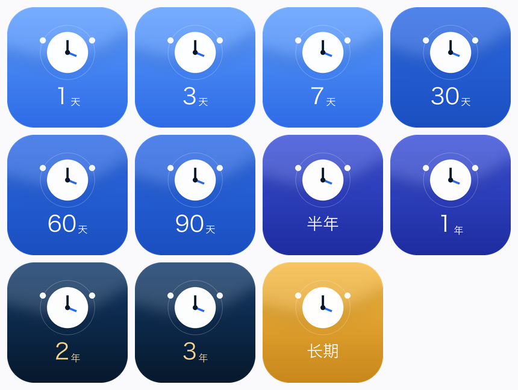

# 道具图（虚拟支付 · 道具直购）

MP 后台「虚拟支付 → 道具管理」每个道具上传一张 200×200 的图片，文件名与道具 ID 对应：

| 道具 ID | 天数 | 图片 | 时长标识 |
| --- | --- | --- | --- |
| pub_1d | 1 | pub-1d.png | 1 天 |
| pub_3d | 3 | pub-3d.png | 3 天 |
| pub_7d | 7 | pub-7d.png | 7 天 |
| pub_30d | 30 | pub-30d.png | 30 天 |
| pub_60d | 60 | pub-60d.png | 60 天 |
| pub_90d | 90 | pub-90d.png | 90 天 |
| pub_180d | 180 | pub-180d.png | 半年 |
| pub_365d | 365 | pub-365d.png | 1 年 |
| pub_730d | 730 | pub-730d.png | 2 年 |
| pub_1095d | 1095 | pub-1095d.png | 3 年 |
| pub_3650d | 3650 | pub-3650d.png | 长期 |

## 设计规则

- 尺寸 200×200、PNG RGBA，圆角 22.5%，与小程序品牌一致。
- 主图形：白色表盘 + 指针（时间），左右轨道节点（公网连接）。
- 按时长分档配色，档位越长期颜色越深、最终转为金色：

| 天数段 | 配色 |
| --- | --- |
| 1–7 天 | 浅海蓝渐变 |
| 30–90 天 | 品牌海洋蓝渐变 |
| 180–365 天 | 靛蓝渐变 |
| 730–1095 天 | 深海蓝渐变 + 鎏金文字 |
| 3650 天 | 金色渐变 |

- 底部标注时长（数字 + 天/年，或「半年」「长期」）。

## 重新生成

图片由 Pillow 脚本生成（4× 超采样后缩放，抗锯齿）。改配色或时长文案后重跑脚本即可，
`props-sheet.png` 是全部档位的对照预览：

通用兜底图：`../prop-pub-network.png`（不带时长标识，任何档位都能用）。
